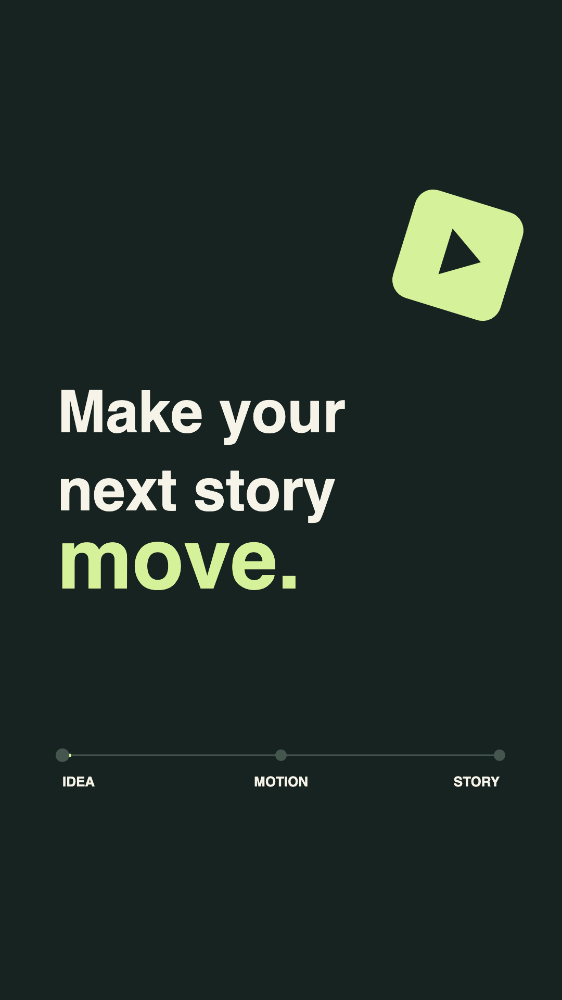

# Motion Reel Studio

Make launch videos, app introductions and short promo reels with the coding
agent you already use.

Give Claude Code or Codex your message, a few screenshots and your logo. It
plans the shots, animates them, shows you previews, takes your notes and
delivers a finished MP4. No motion designer, no After Effects, no video
subscription.



## What you get

- **A video from what you already have.** Screenshots, a logo, a line of copy
  and a sentence about the audience are enough to start.
- **Changes are cheap.** New tagline, new screenshot, different ending: tell
  the agent and rerender. You are editing a file, not reopening a project.
- **Every format from one source.** Vertical for Stories and Shorts, square
  for feeds, wide for a landing page. Same film, different settings.
- **Previews you can trust.** The storyboard, the low-resolution preview and
  the final export come from the same code, so what you approve is what ships.
- **Exports that pass.** A check confirms the size, frame rate, length, audio
  loudness and decoding before you upload anywhere.
- **Sound included.** Mix your own music and effects, normalized to a
  broadcast-safe level.
- **Runs on your machine.** Plain files in a folder. No accounts, no API keys,
  no render credits, and the source stays in git.

## How it works

1. **Brief.** You tell the agent what the film is for, who it is for, how long
   it should be, and where the assets are.
2. **Build and review.** The agent writes a shot list, animates it, and renders
   a contact sheet and a small preview. You comment, it revises.
3. **Deliver.** You get the MP4, a poster, a contact sheet of key frames and the
   editable source for the next version.

## Quick start

Install Node.js 22+, FFmpeg and ffprobe. On macOS:

```sh
brew install node ffmpeg
```

From the repository root:

```sh
npm ci
npm run setup
npm run board
npm run render -- --width 360 --height 640 --fps 30 --output out/demo-preview.mp4
npm run qc -- --width 360 --height 640 --fps 30 --video out/demo-preview.mp4
```

This renders the six-second demo at preview size. `npm run render` alone
exports it at 1080×1920, 60 fps, which takes a few minutes.

Setup installs Chromium and puts the skill where Claude Code and Codex find
it. Rerun it after changing `skills/motion-reel/`. On Linux, Chromium may also
need `npx playwright install-deps chromium`.

## Make your first film

Open the repository in your coding agent and ask:

> Use the motion-reel skill to make a 20-second introduction for [product].
> Assets and references: [folder]. Audience: [audience]. Message: [message].
> Audio: [preference]. Deliver the video, poster, contact sheet and source.

Or start by hand with `npm run new -- --name my-product` and edit the brief,
config and scene in `films/my-product/`.

## Under the hood

A film is a folder with a brief, a settings file and one HTML page that draws
any frame of the animation on a canvas. The scripts open that page in headless
Chromium, capture every frame, and hand them to FFmpeg for encoding. The
bundled skill tells the agent how to go from brief to delivery with those
scripts. [production.md](docs/production.md) has the commands, the scene
contract and the audio cue format. `npm test` runs the whole pipeline.

Workflow inspired by [this thread by Movez](https://x.com/0xMovez/status/2104216919033192746).

[MIT license](LICENSE).
